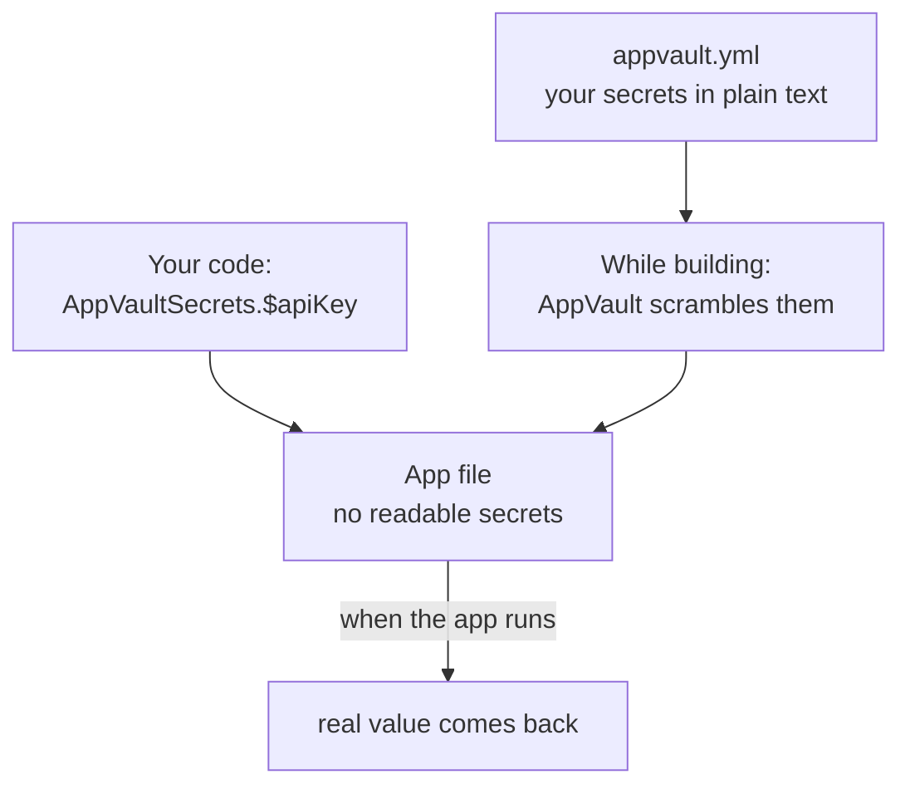
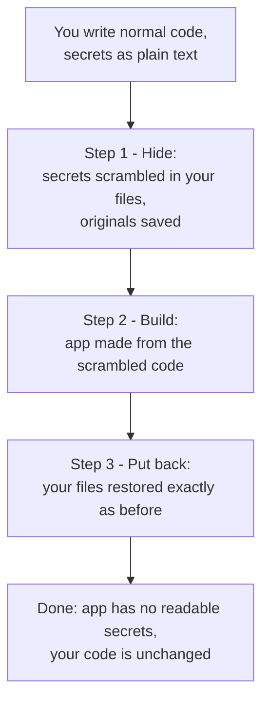

# AppVault (iOS)

**AppVault**, by **Sign3**, hides secret text in your iOS app. Things like API keys, passwords, and
URLs will not show up as plain readable words inside the finished app.

## What is in this repo

- **This README** - a step-by-step guide to add AppVault to your own iOS app.
- **`SampleApp/`** - a small, working example app that already has AppVault set up, demonstrating
  **both** Way 1 (declared secrets in `appvault.yml`) and Way 2 (a protected folder). Open it to see the
  exact files and settings described below. It uses the AppVault package straight from GitHub, so it is
  a real, buildable example.

AppVault itself lives at <https://github.com/Sign3labs/app-vault-ios>.

---

## Why you need this

When you write a secret in your code like this:

```swift
let apiKey = "my-secret-key-123"
```

the words `my-secret-key-123` sit inside your finished app as plain text. Anyone can open the app
file with simple tools and read it. That is a security risk.

AppVault scrambles these secrets **while the app is being built**. The readable version never goes
into the final app. When the app runs, it still gets the real value back. A person looking at the app
file sees only scrambled bytes.

---

## What you need

- A Mac with **Xcode 16 or newer**.
- An iOS app project.

---

## Two ways to use it

| Way | When to use it | What you do |
|---|---|---|
| **Way 1 - List your secrets** | You have a few known secrets, like one API key. | You write each secret in a small file. |
| **Way 2 - Point at a folder** (easiest) | You already have classes full of secret text. | You name a folder. Everything in it is hidden for you. Your code does not change. |

You can use both ways in the same app. Way 2 is the recommended one for most people.

---

# Way 1 - List your secrets

You write your secrets in a small file. AppVault scrambles them. In your code you read them by name.

## Step 1 - Add AppVault to your app

In Xcode, click **File menu → Add Package Dependencies**. Paste this address:

```
https://github.com/Sign3labs/app-vault-ios
```

Choose **Exact Version** and type the latest one (**0.2.0**). Click **Add Package**.

## Step 2 - Turn on the two parts

Open your app target's settings:

- **General → Frameworks, Libraries, and Embedded Content** → add **AppVault**.
- **Build Phases → Run Build Tool Plug-ins** → add **AppVaultPlugin**.

(One part runs inside your app. The other does the scrambling while the app builds.)

## Step 3 - Make a file named `appvault.yml`

This is a plain text file where you list your secrets. Put it right next to your `.xcodeproj` file.

```yaml
algorithm:
  - encrypt using aes-256-gcm
  - shuffle
defaultNamespace: create AppVaultSecrets
defaultAccessModifier: internal
secrets:
  - name: apiKey
    value: my-secret-key-123
  - name: baseURL
    value: https://api.example.com
```

What each line means, in simple words:

- **algorithm** - how to scramble. Just leave it as shown.
- **defaultNamespace** - the name you will type in your code. Leave it as `AppVaultSecrets`.
- **defaultAccessModifier** - who can use the secrets. `internal` is fine for most apps.
- **secrets** - your list. `name` is what you call it in code. `value` is the real secret.

**One important thing:** click the file in Xcode, open the panel on the right, and under
*Target Membership* make sure **no box is ticked**. If a box is ticked, Xcode copies the plain secret
into the app, which cancels the whole point.

> If Xcode cannot find this file, your app still builds but nothing gets scrambled. Later you will see
> the error `cannot find 'AppVaultSecrets'`. If that happens, check this file's location first.

## Step 4 - Use your secrets in code

```swift
import AppVault

let key = AppVaultSecrets.$apiKey
let url = AppVaultSecrets.$baseURL
```

See the `$` sign. That gives you the real value, rebuilt when the app runs.

**How it flows:**



---

# Way 2 - Point at a folder (recommended)

This is the easiest way. You keep your code exactly as it is. You only tell AppVault which folder
holds your secret classes. While building, AppVault hides all the text in those classes, then puts
your files back the way you wrote them. After the build, your files look unchanged.

## What happens (simple picture)



## Step 1 - Add AppVault to your app

Same as Way 1, Step 1 above.

## Step 2 - Make a file named `appvault-classes.yml`

Put it right next to your `.xcodeproj` file. Write the folder that holds your secret classes:

```yaml
packages:
  - MyApp/Secure
```

That is all. Every class inside the `MyApp/Secure` folder is handled for you. You do **not** list
classes one by one.

## Step 3 - Set up the build steps (one command)

AppVault needs to run two small steps during a build: one to hide the secrets, one to put your files
back. You do **not** have to add these by hand. Open **Terminal**, go to your project folder, and run
this once:

```bash
ruby /path/to/AppVault/Scripts/appvault-setup.rb MyApp.xcodeproj
```

- Replace `/path/to/AppVault` with the folder where AppVault lives on your Mac.
- Replace `MyApp.xcodeproj` with your project file name.
- If it says the `xcodeproj` tool is missing, run `gem install xcodeproj` once, then try again.

This command edits your project for you. You can run it again any time; it will not add anything twice.

## Step 4 - Build your app

That is it. Build and run like normal. Your secrets are now hidden in the app, and your code files
look exactly the same as you wrote them.

### If you want to do Step 3 by hand instead

Add two **Run Script** phases to your app target (in **Build Phases**), and set
**Build Settings → User Script Sandboxing → No**.

| Order | Name | Command to paste |
|---|---|---|
| Put it **above** "Compile Sources" | AppVault Stage | `"$APPVAULT_DIR/Scripts/appvault-inplace.sh" stage` |
| Put it as the **last** phase | AppVault Restore | `"$APPVAULT_DIR/Scripts/appvault-inplace.sh" restore` |

In each script, set `APPVAULT_DIR` to the AppVault folder first, for example:

```sh
APPVAULT_DIR="$SRCROOT/path/to/AppVault"
"$APPVAULT_DIR/Scripts/appvault-inplace.sh" stage
```

Keep both phases, in this order. The first hides, the last puts back. If a build is cancelled in the
middle, the next build fixes it by itself.

---

## How to check it really worked

Build your app. Then look inside the built app for your secret. You should **not** find it.

In Terminal:

```bash
strings "MyApp.app/MyApp.debug.dylib" | grep "my-secret-key-123"
```

If it prints nothing, the secret is hidden. (Tip: a secret you did *not* protect will still show up,
which proves the check is real.)

---

## What to keep out of a protected folder (Way 2)

Most normal classes are fine. A few kinds of text can break the build if they are hidden. If your app
stops building after you protect a folder, move that class out of the folder. These are the ones to
watch:

- **Text shown in SwiftUI** like `Text("Hello")` or `Image("icon")`.
- **Special Swift names** like `#selector(...)`, `@objc("name")`, and keys in a dictionary written
  directly in code.
- A value typed as `StaticString`, and a default value of a `public` function.

These are already handled for you and left alone:

- Text joined with a value, like `"Hello \(name)"`. This cannot be a fixed secret, so it stays.
- Enum text values, like `case login = "/login"`. Swift needs these to stay as plain text.

This hides secrets from someone reading the app file. It is one layer of protection, not a complete
anti-tamper system.

---

## For developers - run the tests

```bash
cd AppVault
swift test                       # 48 small tests
./Scripts/inplace-test.sh        # full "hide, build, run, check, put back" test
./Scripts/integration-test.sh    # the mirror build test
./Scripts/cli-test.sh            # command-line checks
```

---

## Versions

AppVault uses version tags. Pin an exact version (`exact: "0.2.0"`) so your builds stay the same every
time. See [CHANGELOG.md](CHANGELOG.md) for what changed in each version.
